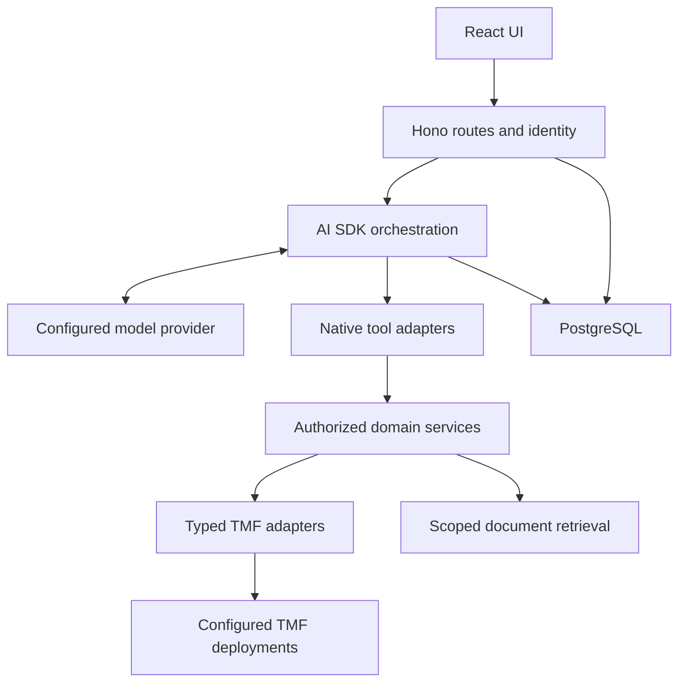

# Architecture

## Deployment unit

One TypeScript application: a **Hono** HTTP server (identity, agent orchestration, TMF access) plus a **React** UI. Primary runtime is **Cloudflare Workers**; the same Hono app also runs on Node. PostgreSQL stores conversation state, turns, evidence and feedback. The model provider and TMF systems are external dependencies. No MCP server or client is included.

## Boundaries

| Layer | Owns | Must not own |
| --- | --- | --- |
| UI | Rendering, composer, accessible progress, feedback | Secrets, policy decisions, API URLs selected by the model |
| HTTP application | Identity, validation, ownership, idempotency, stream lifecycle | TMF version-specific parsing |
| Agent | Model instructions, tool selection, budgets, synthesis | Granting permissions or raw HTTP |
| Tool adapters | AI SDK schemas/descriptions and execution wrapper | Business logic duplicated per SDK |
| Domain | Authorized correlation, normalization, evidence creation | SDK transport, provider-specific messages |
| Integrations | TMF HTTP/version handling and document loading | User-facing generated claims |
| Storage | Transactions, tenant-scoped queries, lifecycle | Deciding which external data a user may access |

Domain services and their schemas remain independent of the AI SDK registration so a future interface can reuse them without today's application paying for another protocol boundary.

## Runtime modes

`APP_MODE=local` allows an explicitly configured fixture deployment and local test identities. `APP_MODE=demo` supports an authenticated hosted demonstration using fixture profiles only. `APP_MODE=production` requires OIDC, a configured authorization provider, a reviewed live TMF deployment profile and an approved model provider. Invalid combinations fail startup. A local missing model key selects scripted mode only if explicitly configured; it never silently pretends to be a real model.

## Technology choices

Use Hono + React (Vite), strict TypeScript, Zod for runtime boundaries, AI SDK Core/UI with a provider factory, Drizzle + pg for PostgreSQL, Vitest for unit/integration tests, MSW or an equivalent local HTTP fixture server for adapter faults, Playwright for browser tests, and OpenTelemetry for tracing. Use a maintained OIDC client library rather than implementing OAuth cryptography. Use pnpm, a supported Node LTS compatible with selected dependencies, and Docker Compose for local PostgreSQL. UI styling: Tailwind and accessible React primitives; no requirement for a proprietary UI service.

Resolve and pin compatible stable versions in milestone 0. The design does not require the newest SDK major. Compile a minimal native-tool, structured-output, and UI-stream example against the resolved packages before building the orchestration.

## Repository placement

Compass is independent from Forge and the sandbox. Forge may checkout Compass to implement tasks; it is not a runtime dependency. Telecom API Sandbox is the default configured backend for local development. It is an external TMF deployment, not an application-code dependency or a source of special domain rules. Independent fixtures serve automated tests; real deployments use their own profiles. Optional Forge integration examples live under `integrations/forge/`; related repos are listed in `docs/references.md`.

Cloudflare Workers is the primary target specified in [the deployment guide](operations/cloudflare.md). Runtime configuration, database connections and telemetry have thin platform adapters; domain/tool behavior stays identical. See ADR [0009](adr/0009-native-cloudflare-hono.md).
